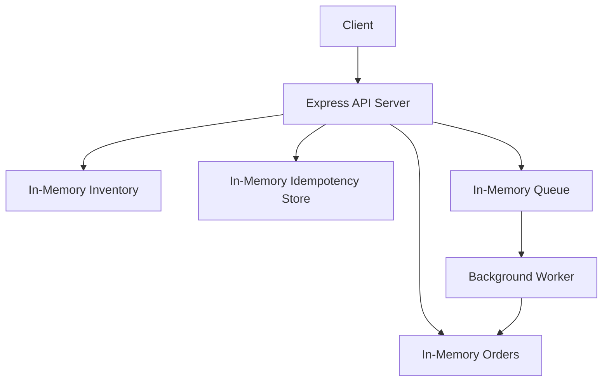

# ⚡ FlashDrop — Flash-Sale Order Processing System

A high-throughput, concurrency-safe order processing system built for flash-sale scenarios where thousands of users compete for limited inventory simultaneously.

---

## Problem Statement & Objective

Flash sales create extreme concurrency pressure. Thousands of users attempt to purchase limited stock within seconds, and naive implementations lead to overselling, duplicate charges, and unresponsive servers. FlashDrop addresses this by ensuring:

- **Never oversell** — inventory must never go negative, even under concurrent load
- **Handle duplicate requests safely** — idempotency guarantees no double-charging on retries
- **Process orders asynchronously** — immediate acknowledgment with background fulfillment
- **Scale to production** — architecture designed to evolve from in-memory to distributed infrastructure

---

## Key Features

- **Input Validation** — strict schema enforcement on all incoming requests
- **Idempotent Order Placement** — duplicate requests return the original order instead of creating a new one
- **Atomic Stock Reservation** — synchronous check-and-deduct prevents race conditions
- **Async Background Processing** — orders are queued and processed by a dedicated worker
- **Structured Error Handling** — consistent error responses with meaningful status codes
- **Concurrency-Safe Design** — leverages Node.js single-threaded execution to eliminate data races

---

## Technology Stack

| Technology | Purpose |
|------------|---------|
| Node.js | Runtime environment |
| Express.js | HTTP server and routing |
| uuid | Unique order ID generation |
| In-Memory Store | Inventory, orders, idempotency, and queue storage |
| Node.js Test Runner | Built-in test framework |

---

## Project Structure

```
flashdrop/
├── package.json              # Dependencies and scripts
├── .gitignore                # Git ignore rules
├── README.md                 # Project documentation
├── docs/
│   └── architecture.md       # Production architecture design
├── src/
│   ├── server.js             # Express server entry point
│   ├── routes/
│   │   └── orderRoutes.js    # API route definitions
│   ├── store/
│   │   └── memoryStore.js    # In-memory data stores
│   ├── workers/
│   │   └── orderWorker.js    # Background order processor
│   └── middleware/
│       └── errorHandler.js   # Centralized error handling
└── tests/
    └── flashdrop.test.js     # Test suite
```

---

## Installation & Setup

```bash
git clone https://github.com/AlapatiAbhinavChowdhary/Newtonite.git
cd Newtonite
npm install
```

---

## Running the Application

```bash
npm start         # Start the server
npm test          # Run all tests
npm run dev       # Development mode with auto-reload
```

Server runs on **http://localhost:3000**

---

## API Documentation

### POST `/orders` — Place an Order

**Method:** `POST`
**Content-Type:** `application/json`

#### Request Body

| Field | Type | Required | Description |
|-------|------|----------|-------------|
| `userId` | string | ✅ | Unique identifier of the purchasing user |
| `productId` | string | ✅ | Product to purchase (e.g., `iphone_16`) |
| `quantity` | integer | ✅ | Number of units to order (must be a positive integer) |
| `idempotencyKey` | string | ✅ | Client-generated unique key to prevent duplicates |

#### Response — 201 Created (Success)

```json
{
  "success": true,
  "orderId": "a1b2c3d4-e5f6-7890-abcd-ef1234567890",
  "status": "PENDING"
}
```

#### Response — 200 OK (Idempotent Duplicate)

```json
{
  "success": true,
  "message": "Duplicate request — returning existing order",
  "order": {
    "orderId": "a1b2c3d4-e5f6-7890-abcd-ef1234567890",
    "userId": "user-42",
    "productId": "iphone_16",
    "quantity": 2,
    "status": "CONFIRMED",
    "createdAt": "2025-01-15T10:30:00.000Z",
    "updatedAt": "2025-01-15T10:30:01.200Z"
  }
}
```

#### Response — 400 Bad Request (Validation Error)

```json
{
  "success": false,
  "error": "Missing required fields: userId, productId, quantity, idempotencyKey"
}
```

#### Response — 404 Not Found (Unknown Product)

```json
{
  "success": false,
  "error": "Product \"galaxy_s99\" not found"
}
```

#### Response — 409 Conflict (Insufficient Stock)

```json
{
  "success": false,
  "error": "Insufficient stock for \"iphone_16\". Requested: 5, available: 2"
}
```

---

### GET `/orders/:orderId` — Get Order Details

**Method:** `GET`

#### URL Parameters

| Parameter | Type | Required | Description |
|-----------|------|----------|-------------|
| `orderId` | string | ✅ | UUID of the order to retrieve |

#### Response — 200 OK

```json
{
  "success": true,
  "order": {
    "orderId": "a1b2c3d4-e5f6-7890-abcd-ef1234567890",
    "userId": "user-42",
    "productId": "iphone_16",
    "quantity": 2,
    "status": "CONFIRMED",
    "createdAt": "2026-11-04T10:30:00.000Z",
    "updatedAt": "2026-11-04T10:30:01.200Z"
  }
}
```

#### Response — 404 Not Found

```json
{
  "success": false,
  "error": "Order \"a1b2c3d4-e5f6-7890-abcd-ef1234567890\" not found"
}
```

---

### GET `/orders` — List All Orders

**Method:** `GET`

Returns all accepted orders currently stored in the in-memory store.

#### Response — 200 OK

```json
{
  "success": true,
  "count": 1,
  "orders": [
    {
      "orderId": "a1b2c3d4-e5f6-7890-abcd-ef1234567890",
      "userId": "user-42",
      "productId": "iphone_16",
      "quantity": 2,
      "status": "CONFIRMED",
      "createdAt": "2026-11-04T10:30:00.000Z",
      "updatedAt": "2026-11-04T10:30:01.200Z"
    }
  ]
}
```

---

### GET `/inventory` — Check Inventory

**Method:** `GET`

Returns the current stock levels for all products in memory.

#### Response — 200 OK

```json
{
  "success": true,
  "inventory": {
    "iphone_16": {
      "productId": "iphone_16",
      "name": "iPhone 16",
      "stock": 98
    }
  }
}
```

---

### GET `/health` — Health Check

**Method:** `GET`

Returns service health status for load balancer monitoring.

#### Response — 200 OK

```json
{
  "status": "ok",
  "service": "FlashDrop"
}
```

---

### GET `/orders/queue/status` — Queue Status

**Method:** `GET`

Returns the number of pending jobs currently waiting in the background processing queue.

#### Response — 200 OK

```json
{
  "success": true,
  "queueLength": 0
}
```

---

## Concurrency Handling

FlashDrop leverages the **Node.js single-threaded event loop** to achieve concurrency safety without locks or mutexes.

The `reserveStock()` function performs the **check-and-deduct operation synchronously within a single tick** of the event loop. Because there is no `await` or asynchronous boundary between reading the current stock and mutating it, no other request can interleave during that critical section. This eliminates the classic **check-then-act race condition** (TOCTOU) entirely.

```
Request A: read stock (10) → deduct → stock = 8    ✅ Atomic within one tick
Request B: read stock (8)  → deduct → stock = 6    ✅ Runs after A completes
```

> [!NOTE]
> This guarantee holds for a single Node.js process. In a production multi-process deployment, you would use **PostgreSQL `SELECT ... FOR UPDATE`** row-level locking to maintain atomicity across instances.

---

## Idempotency

FlashDrop implements **client-driven idempotency** to prevent duplicate orders on retries:

1. The client generates a unique `idempotencyKey` and includes it with every order request.
2. The server maintains an in-memory `idempotencyKey → orderId` mapping.
3. On receiving a request, the server checks the map **before** creating a new order.
4. If the key already exists, the server returns the **existing order** with a `200` status instead of creating a duplicate.

This prevents double-charging when a client retries due to network timeouts or failed responses — the order is only created once regardless of how many times the request is sent.

---

## Background Worker

The order worker simulates asynchronous order fulfillment:

1. **Polls** the in-memory queue every **500ms** via `setInterval`
2. **Dequeues one job** per tick to prevent blocking
3. **Checks** the order is still `PENDING` (guards against duplicate processing)
4. **Simulates processing** with an 800ms delay (representing payment/fulfillment)
5. **Updates status** to `CONFIRMED` or `FAILED`

> [!TIP]
> In production, this polling worker would be replaced by a **Kafka consumer group**, providing durable message delivery, consumer scaling, and automatic partition rebalancing.

---

## Architecture

### Current Implementation



### Production Architecture

See [docs/architecture.md](docs/architecture.md) for the complete production architecture diagram with Kafka, PostgreSQL, Redis, and AWS infrastructure.

---

## Deployment Strategy

### Containerization

Multi-stage Dockerfile to produce a minimal production image:
- **Build stage** — install all dependencies, run linting
- **Production stage** — copy only production `node_modules` and source code

### CI/CD

GitHub Actions pipeline:
1. **Build** — install dependencies
2. **Test** — run full test suite
3. **Push** — build and push Docker image to AWS ECR
4. **Deploy** — update ECS service with new task definition

### AWS Infrastructure

| Service | Role |
|---------|------|
| ECS Fargate | Run API servers and worker containers |
| RDS PostgreSQL (Multi-AZ) | Durable order and inventory storage |
| MSK (Managed Kafka) | Reliable event streaming between API and workers |
| ElastiCache (Redis) | Caching, rate limiting, and idempotency store |
| ALB | Load balancing across API instances |
| Secrets Manager | Secure credential storage |
| CloudWatch | Logging, metrics, and alerting |

### Scaling

- **API** — horizontal scaling via ECS service auto-scaling based on CPU/request metrics
- **Workers** — Kafka consumer groups enable adding worker instances per partition
- **Database** — RDS read replicas for query-heavy endpoints

### Reliability

- Multi-AZ database deployment for automatic failover
- Automated daily backups with point-in-time recovery
- Rolling deployments with health checks to prevent bad releases

---

## Failure Scenarios & Solutions

### Scenario 1: Kafka delivers an order event twice

**Problem:** Kafka provides at-least-once delivery, meaning a message may be delivered more than once after a consumer rebalance or acknowledgment failure.

**Solution:** Workers are **idempotent consumers**. Before processing, the worker checks the order's current status. If the status is no longer `PENDING` (i.e., already `CONFIRMED` or `FAILED`), the worker skips processing and acknowledges the message. No duplicate side effects occur.

---

### Scenario 2: Redis becomes unavailable after order is accepted

**Problem:** The caching layer goes down, potentially blocking inventory lookups or idempotency checks.

**Solution:** **PostgreSQL is the source of truth**, not Redis. The API falls back to direct database queries when Redis is unavailable. Redis serves as a performance optimization layer — the system remains **correct** without it, only slower.

---

### Scenario 3: Worker crashes after writing to DB but before acknowledging Kafka

**Problem:** Kafka does not receive the offset commit and redelivers the message to another worker.

**Solution:** The worker's **status guard** checks if the order is already `CONFIRMED` before processing. Since the database write was successful, the order status is no longer `PENDING`, so the new worker skips it. The idempotent write pattern ensures no double-processing.

---

### Scenario 4: API crashes after accepting order but before responding to client

**Problem:** The client receives a network error and does not know whether the order was created.

**Solution:** The client **retries with the same `idempotencyKey`**. The server finds the existing order mapped to that key and returns it with a `200` status. No duplicate order is created, and the client receives its order confirmation.

---

## Limitations & Future Improvements

### Current Limitations

- **In-memory stores** — all data is lost on server restart
- **Single process** — cannot horizontally scale the current implementation
- **No authentication/authorization** — API endpoints are open
- **No rate limiting** — vulnerable to abuse under real traffic
- **No persistent message queue** — queued jobs are lost if the server crashes

### Future Improvements

- **PostgreSQL** for durable order and inventory storage
- **Redis** for caching, rate limiting, and distributed idempotency checks
- **Kafka** for reliable, persistent event streaming between services
- **Docker + Kubernetes/ECS** for containerized, scalable deployment
- **JWT authentication** for securing API endpoints
- **Monitoring and alerting** via CloudWatch or Prometheus/Grafana

---

## Testing

Run the full test suite:

```bash
npm test
```

The test suite covers:
- Order creation and response structure
- Input validation and error responses
- Idempotency (duplicate key handling)
- **Concurrency** (10,000 simultaneous requests against limited stock)
- Inventory integrity (stock never goes negative)
- Worker status transitions (`PENDING` → `CONFIRMED` and `PENDING` → `FAILED` on processing errors)
- Order retrieval (`GET /orders/:orderId`) and field validation
- System inspection endpoints (`GET /inventory`, `GET /health`, `GET /orders/queue/status`)

---

## License & Author

**Author:** Alapati Abhinav Chowdhary

**Assessment:** Newtonite Software Engineering Assessment

**Repository:** [github.com/AlapatiAbhinavChowdhary/Newtonite](https://github.com/AlapatiAbhinavChowdhary/Newtonite)
