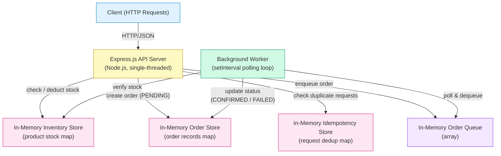
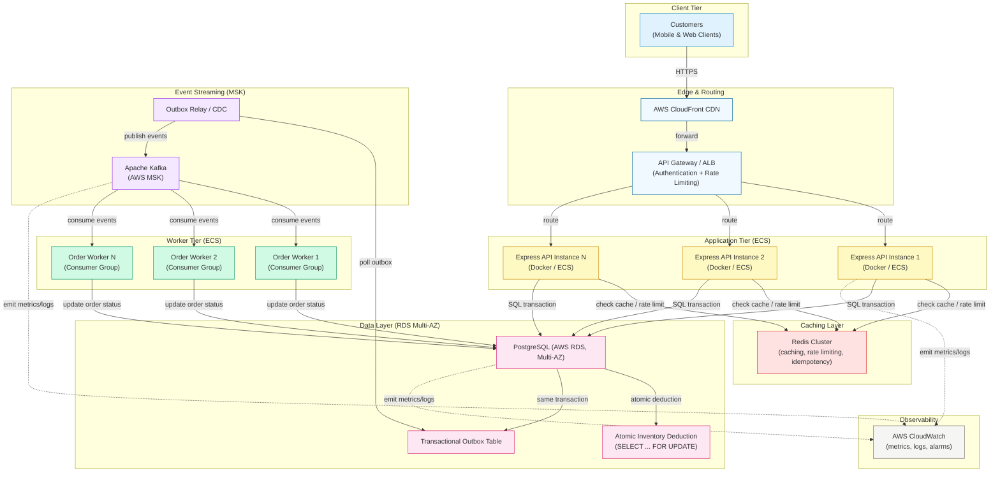
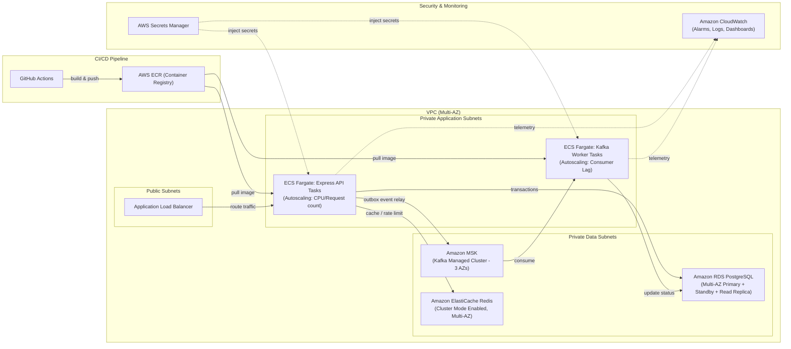

# FlashDrop — System Architecture

This document describes the architecture of FlashDrop, a flash-sale order processing system. It covers the **current in-memory prototype** and the **proposed production-grade architecture**.

---

## Section A: Current Implementation Architecture



### How It Works

- **HTTP Ingestion** — Clients submit order requests via REST endpoints to a single Express.js server. Each request carries a product ID, quantity, and an idempotency key.
- **Idempotency Check** — Before processing, the server checks the in-memory idempotency store to reject duplicate submissions and guarantee at-most-once order creation per key.
- **Stock Reservation & Order Creation** — The server deducts the requested quantity from the in-memory inventory map and writes a new order record with status `PENDING` to the in-memory order store.
- **Queue & Async Processing** — The order is pushed onto an in-memory array-based queue. A `setInterval` background worker continuously polls this queue, picks up pending orders, performs final validation, and transitions each order to `CONFIRMED` or `FAILED`.
- **Single-Process Limitation** — All state lives in a single Node.js process. A restart or crash loses every order, inventory count, and idempotency record. This design is strictly a prototype for validating business logic.

---

## Section B: Proposed Production Architecture

> [!IMPORTANT]
> The architecture below is a **proposed design** — none of these components (Redis, Kafka, PostgreSQL, ECS, etc.) are implemented yet. The current system is purely in-memory.



### Key Production Design Decisions

1. **Atomic Stock Reservation** — Inventory is deducted inside a PostgreSQL transaction using `SELECT ... FOR UPDATE` to lock the product row before decrementing stock. This prevents two concurrent requests from both reading the same count and overselling. The lock is held only for the duration of the short transaction, keeping contention minimal.

2. **Transactional Outbox Pattern** — Instead of publishing directly to Kafka after a database commit (which risks message loss if the publish fails), the order event is written to an `outbox` table within the **same** SQL transaction that reserves stock and creates the order. A separate Outbox Relay process polls this table (or uses CDC) and publishes events to Kafka, guaranteeing at-least-once delivery without two-phase commits.

3. **Idempotent Consumers** — Kafka provides at-least-once delivery semantics, meaning a worker may receive the same event more than once during rebalances or retries. Each worker must therefore check whether it has already processed a given order event (e.g., via a unique event ID stored in PostgreSQL) before applying side effects, ensuring exactly-once business outcomes.

4. **Horizontal Scaling** — Multiple Express API instances run behind an ALB, allowing the application tier to scale out under flash-sale traffic spikes. On the consumer side, Kafka consumer groups automatically distribute partitions across worker instances, so adding more ECS tasks increases processing throughput linearly.

5. **Redis Caching** — A Redis cluster sits in front of PostgreSQL to serve hot stock-count reads, enforce per-user rate limits, and optionally store idempotency keys with short TTLs. This dramatically reduces direct database load during traffic bursts and keeps p99 latencies low for stock-check endpoints.

### Current vs Production Comparison

| Component | Current Prototype | Production Target |
|---|---|---|
| **Web Server** | Single Express.js process | Multiple Express instances on AWS ECS behind ALB |
| **Inventory Store** | In-memory JavaScript `Map` | PostgreSQL (RDS Multi-AZ) with row-level locking |
| **Order Store** | In-memory JavaScript `Map` | PostgreSQL (RDS Multi-AZ) with durable tables |
| **Idempotency** | In-memory JavaScript `Map` | Redis (TTL-based keys) + PostgreSQL unique constraints |
| **Message Queue** | In-memory array, polled by `setInterval` | Apache Kafka (AWS MSK) with partitioned topics |
| **Background Workers** | Single `setInterval` loop in the same process | Kafka consumer group across multiple ECS tasks |
| **Deployment** | Local `node` process | Docker containers on AWS ECS with CI/CD pipeline |
| **Scaling** | None (single process) | Horizontal auto-scaling for API and worker tiers |
| **Monitoring** | Console logs | AWS CloudWatch (metrics, structured logs, alarms) |

---

## Section C: Failure Scenarios & Resilience Architecture

In a distributed flash-sale environment, failures are inevitable. The table and sections below define how the proposed architecture handles the four critical failure scenarios.

```
┌────────────────────────────────────────────────────────────────────────────────────────┐
│                              FAILURE SCENARIO MATRIX                                   │
├────────────────────────────┬─────────────────────────────┬─────────────────────────────┤
│ Failure Scenario           │ Risk / Failure Mode         │ Architecture Solution       │
├────────────────────────────┼─────────────────────────────┼─────────────────────────────┤
│ 1. Kafka duplicate event   │ Double-fulfillment, double  │ Idempotent Consumers with   │
│    delivery                │ charge                      │ status guard & DB versioning│
├────────────────────────────┼─────────────────────────────┼─────────────────────────────┤
│ 2. Redis outage after      │ Stale reads, cache failure  │ PostgreSQL source of truth; │
│    order accepted          │                             │ graceful degraded bypass    │
├────────────────────────────┼─────────────────────────────┼─────────────────────────────┤
│ 3. Worker crash before     │ Message redelivery to       │ Transactional status guard; │
│    Kafka ACK               │ next consumer               │ offset re-read idempotency  │
├────────────────────────────┼─────────────────────────────┼─────────────────────────────┤
│ 4. API crash before client │ Client timeout, unknown     │ Client retry with identical │
│    receives HTTP response  │ order state                 │ Idempotency-Key returns 200 │
└────────────────────────────┴─────────────────────────────┴─────────────────────────────┘
```

### 1. Kafka Delivers an Order Event Twice

- **Failure Condition:** Kafka guarantees *at-least-once* delivery. During network hiccups, consumer group rebalances, or broker partition leadership transfers, the same message offset can be re-delivered to a worker.
- **Root Cause Prevention:** Workers operate as **Idempotent Consumers**. Before processing any side effect (payment capture, warehouse notification, email dispatch), the worker queries the authoritative order record in PostgreSQL within a transaction:
  ```sql
  SELECT status FROM orders WHERE order_id = $1 FOR UPDATE;
  ```
  If the status is already `CONFIRMED`, `FAILED`, or `PROCESSING`, the worker logs the duplicate event, commits the Kafka offset immediately, and skips processing.
- **Result:** Exactly-once business outcome despite at-least-once message transport.

---

### 2. Redis Becomes Unavailable After an Order Is Accepted

- **Failure Condition:** An ElastiCache Redis node or cluster suffers a network partition, failover, or OOM event immediately after an order is accepted.
- **Root Cause Prevention:** Redis is designed strictly as an **ephemeral performance acceleration layer** (read cache, distributed rate limiting, and fast-path idempotency cache). It is **never** the system of record.
  - The API layer wraps all Redis interactions in non-blocking try-catch / timeout blocks (circuit breaker pattern).
  - If Redis fails, the API gracefully degrades and falls back directly to PostgreSQL:
    - Stock verification falls back to `SELECT stock FROM products WHERE product_id = $1;`.
    - Idempotency checks fall back to querying the `orders` table using the unique `idempotency_key` constraint.
- **Result:** Increased query latency on the database tier during the Redis outage, but zero lost orders and zero data corruption.

---

### 3. Worker Crashes After Writing to Database but Before Acknowledging Kafka

- **Failure Condition:** A worker node processes an order, successfully commits the status change (`CONFIRMED`) to PostgreSQL, but terminates (OOM, SIGKILL, EC2 hardware failure) before issuing the manual Kafka offset commit (`commitSync` / `commitAsync`). Kafka then re-assigns the partition to another worker node which consumes the same event again.
- **Root Cause Prevention:**
  - The newly assigned worker reads the order event from Kafka and opens a database transaction.
  - The worker checks the order's state in PostgreSQL:
    ```sql
    SELECT status FROM orders WHERE order_id = $1;
    ```
  - Since the previous worker already committed `status = 'CONFIRMED'`, the new worker detects that the order is already in a terminal state.
  - The worker bypasses payment and warehouse operations, immediately commits the Kafka offset, and proceeds to the next record.
- **Result:** Safe recovery with zero duplicated business actions.

---

### 4. API Crashes After Accepting Order but Before Responding to Client

- **Failure Condition:** The Express API instance reserves stock in PostgreSQL, inserts the order record (`PENDING`), writes to the transactional outbox, and commits the transaction. However, before the HTTP `201 Created` JSON response is sent over the wire, the container crashes or the client experiences a network timeout.
- **Root Cause Prevention:**
  - The client is programmed with standard retry logic using an exponential backoff policy and transmits the **exact same `idempotencyKey`**.
  - When the retry lands on any healthy Express instance, the endpoint executes:
    ```sql
    SELECT order_id, user_id, product_id, quantity, status, created_at, updated_at
    FROM orders
    WHERE idempotency_key = $1;
    ```
  - Finding the existing record, the server immediately responds with HTTP `200 OK` (or `200` with duplicate indicator) and the existing order payload.
  - Stock is not deducted again, and no new background job is triggered.
- **Result:** Seamless client recovery without duplicate orders or stock leakage.

---

## Section D: AWS Production Deployment Strategy

The target deployment leverages AWS managed cloud services to deliver high availability, automated scaling, and zero-downtime deployments.



### Infrastructure Components

1. **Containerization (Docker)**
   - Multi-stage Docker builds separating build dependencies from the minimal production runtime image.
   - Non-root user execution (`USER node`) for least-privilege security compliance.
   - Lightweight Alpine or Debian-slim base images with pinned versions.

2. **Compute: AWS ECS Fargate**
   - Serverless container execution eliminating EC2 patching overhead.
   - Separate ECS task definitions for the **Express API service** and the **Background Kafka Worker service**.
   - Rolling deployments with `minimumHealthyPercent = 100` and `maximumPercent = 200` ensuring zero downtime during updates.

3. **Storage: Amazon RDS for PostgreSQL (Multi-AZ)**
   - Synchronous replication across two Availability Zones for automatic failover under 60 seconds.
   - Dedicated Read Replica for analytics and heavy read queries (`GET /orders`, reporting).
   - Automated daily snapshots retained for 30 days with Point-In-Time Recovery (PITR) to any second within the retention window.

4. **Event Streaming: Amazon MSK (Managed Streaming for Apache Kafka)**
   - Multi-AZ broker distribution across 3 availability zones.
   - Topic `orders.v1` configured with partitions equal to the target worker concurrency (e.g., 12 partitions).
   - TLS encryption in transit and AWS KMS encryption at rest.

5. **Caching: Amazon ElastiCache for Redis**
   - Cluster mode enabled with automatic failover across Multi-AZ replicas.
   - In-memory caching for hot inventory stock counts and distributed rate limiting buckets.

6. **CI/CD Pipeline: GitHub Actions**
   - Triggered on push to `main` branch:
     1. Run automated test suite (`npm test`).
     2. Run security vulnerability scans (`npm audit`).
     3. Build multi-platform Docker container image.
     4. Authenticate and push image to Amazon Elastic Container Registry (ECR).
     5. Update ECS Task Definition and trigger rolling deployment.

7. **Secrets & Security: AWS Secrets Manager & IAM**
   - Zero hardcoded credentials or `.env` files in git.
   - Database credentials, Kafka certificates, and API keys retrieved dynamically at container startup via ECS Task IAM roles.
   - Strict Security Group rules: ECS API only accessible from ALB; RDS and Redis only accessible from ECS Security Groups.

8. **Observability: Amazon CloudWatch & Alarms**
   - Centralized JSON log streaming with structured request IDs for distributed tracing.
   - High-priority alarms configured for:
     - ECS CPU / Memory utilization > 75%.
     - ALB HTTP 5xx rate > 1%.
     - Kafka Consumer Group lag > 500 messages (triggers worker task auto-scaling).
     - RDS storage space < 20% and CPU utilization > 80%.

---

## Section E: Component Responsibilities & Technical Reference

| Component | Responsibility in Prototype | Responsibility in Production Target |
|---|---|---|
| **Express Router** | Validates schema, routes requests, checks idempotency map | Validates schema, delegates auth to ALB, checks Redis cache |
| **Inventory Manager** | Single-tick synchronous check and deduction in RAM | Atomic conditional SQL update (`UPDATE ... WHERE available >= $1`) |
| **Idempotency Store** | In-memory key-to-orderId map | Redis TTL cache + PostgreSQL unique constraint on `idempotency_key` |
| **Order Queue** | In-memory FIFO JavaScript array | Partitioned Apache Kafka topic (`orders.v1`) on Amazon MSK |
| **Order Worker** | Single-flight setInterval polling loop | Kafka Consumer Group instances with manual offset commitment |
| **Error Middleware** | Catches exceptions, returns structured JSON errors | Global middleware + Sentry / CloudWatch structured error logging |

### Production PostgreSQL DDL Schema

```sql
-- Authoritative Inventory & Order Schema
CREATE TABLE products (
    id VARCHAR(64) PRIMARY KEY,
    name VARCHAR(255) NOT NULL,
    price NUMERIC(10, 2) NOT NULL,
    created_at TIMESTAMPTZ DEFAULT NOW()
);

CREATE TABLE inventory (
    product_id VARCHAR(64) PRIMARY KEY REFERENCES products(id),
    available INTEGER NOT NULL CHECK (available >= 0),
    reserved INTEGER NOT NULL DEFAULT 0 CHECK (reserved >= 0),
    version INTEGER NOT NULL DEFAULT 1,
    updated_at TIMESTAMPTZ DEFAULT NOW()
);

CREATE TYPE order_status AS ENUM ('PENDING', 'CONFIRMED', 'FAILED');

CREATE TABLE orders (
    id UUID PRIMARY KEY,
    user_id VARCHAR(64) NOT NULL,
    product_id VARCHAR(64) NOT NULL REFERENCES products(id),
    quantity INTEGER NOT NULL CHECK (quantity > 0),
    status order_status NOT NULL DEFAULT 'PENDING',
    idempotency_key VARCHAR(128) NOT NULL UNIQUE,
    created_at TIMESTAMPTZ DEFAULT NOW(),
    updated_at TIMESTAMPTZ
);

CREATE TABLE outbox_events (
    id UUID PRIMARY KEY,
    aggregate_type VARCHAR(64) NOT NULL,
    aggregate_id VARCHAR(64) NOT NULL,
    event_type VARCHAR(64) NOT NULL,
    payload JSONB NOT NULL,
    status VARCHAR(32) NOT NULL DEFAULT 'PENDING',
    created_at TIMESTAMPTZ DEFAULT NOW()
);

CREATE TABLE processed_events (
    event_id VARCHAR(128) PRIMARY KEY,
    consumer_group VARCHAR(64) NOT NULL,
    processed_at TIMESTAMPTZ DEFAULT NOW()
);
```
